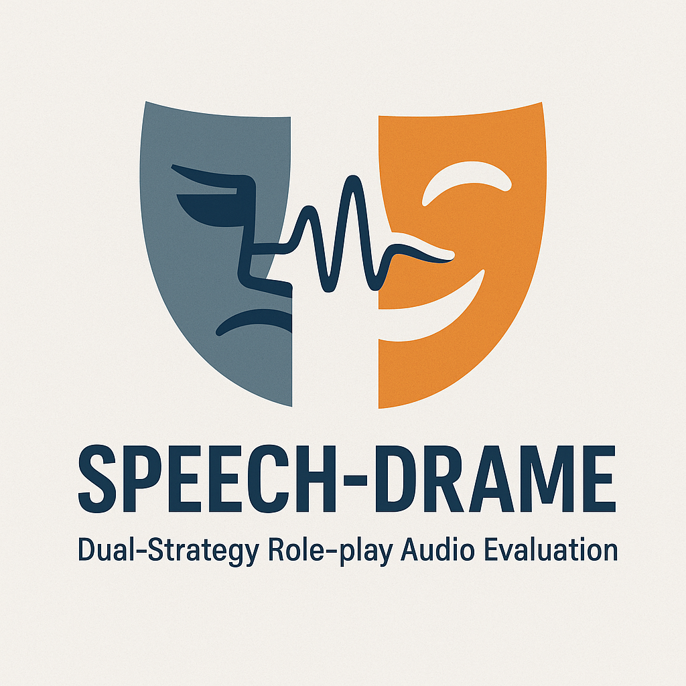

<div align="center">
  
  <h1>Speech-DRAME: Human-Aligned Evaluation for Speech Role-Play</h1>
  
</div>

[](LICENSE)
[](https://arxiv.org/abs/2511.01261)

[Revised manuscript](https://openreview.net/forum?id=m9IP9ECrk2) ·
[Project page](https://ftshijt.github.io/speech_drame/) ·
[Dataset-to-results guide](docs/RUNNING.md) ·
[Rebuttal analyses](analysis/README.md)

Speech-DRAME evaluates speech role-play against bilingual human ratings using two
protocols: **archetype** evaluation measures fit to a role and scene, and
**realism** evaluation measures delivery and contextual fit against a profile and
scene. DRAME-Eval is a fine-tuned audio-language evaluator used to study alignment
with those ratings.

The revised results show strong alignment within the benchmark distribution and
a substantial transfer gap on authentic human performances. DRAME-Eval reaches
pooled Pearson correlations of **0.629** on archetype and **0.602** on realism,
but **−0.142** on clean held-out authentic speech. Its within-speaker authentic
correlation is **+0.029**, compared with the matched human reference of **+0.340**.
These results do not establish reliable automatic judging of authentic acting or
ranking of new speech generation systems.

## Start here

The entry point connects **dataset → prepared inputs → inference or training →
scoring**. Run commands from the repository root in a checkout containing
[run.py](run.py).

Use Python 3.10 or later for the workflow and scoring. GPU model runs use the
saved experiment's Python 3.10/3.11 package stack and need a compatible Linux/CUDA
environment; create a separate model environment if your default Python differs.

```bash
python3 -m venv .venv
source .venv/bin/activate
python -m pip install -r requirements/workflow.txt
python run.py options
python run.py demo --output runs/demo
```

The offline demo prepares generated tone WAVs and scores fixed test predictions.
It needs no dataset, model weights, API key, or GPU. The output
`runs/demo/prepared/scores.json` is marked `workflow.demo_fixture: true`; it is a
workflow check, **not a benchmark or model result**. Choose a new output directory
when rerunning: commands do not overwrite existing runs.

| What you have | Runnable path | What else you need |
| --- | --- | --- |
| No released data or checkpoint | `demo` | Workflow dependencies only |
| Canonical labels and saved predictions | `prepare --score-only` → `score --predictions` | No audio or model |
| Metadata and reconstructed audio | `prepare` → `infer` → `score` | Local model/GPU or cloud account |
| Metadata and mel features only | Score saved predictions; reconstruct audio before inference | Pinned reconstruction recipe or companion audio snapshot; `--audio-map` for local reconstructions |
| Labeled training data and audio | `prepare --purpose train` → `train` | GPU training dependencies and an explicit YAML recipe |
| Your DRAME checkpoint | `infer --backend drame` → `score` | Full weights or a LoRA adapter plus its base model |

The [running guide](docs/RUNNING.md) gives complete commands for each path,
including dataset download by revision, few-shot examples, clean authentic-speech
manifests, modality controls, and training.

## Run a dataset through an evaluator

For an actual snapshot, replace `/data/realism` with the track's release root.
`--asset-root` is the directory relative to which the metadata's audio paths
resolve. The snapshot must contain canonical metadata and reconstructed waveforms.

In a Python 3.10/3.11 model environment:

```bash
python -m pip install -r requirements/local.txt
python run.py prepare --track realism \
  --metadata /data/realism/metadata/test_base.jsonl \
  --asset-root /data/realism --output runs/realism-test
python run.py infer --workdir runs/realism-test \
  --backend qwen2audio --name qwen-zs --dry-run
```

The dry run checks prepared inputs and prints the exact command without loading
a model. To execute it and then score the saved predictions:

```bash
python run.py infer --workdir runs/realism-test \
  --backend qwen2audio --name qwen-zs
python run.py score --workdir runs/realism-test --name qwen-zs
```

Results are written to `runs/realism-test/scores-qwen-zs.json`, including coverage,
per-dimension and per-language correlations, the dimension-average Pearson, and
sample-bootstrap intervals. An undefined dimension makes the headline average
`null`. The run records input and prediction hashes. Dry runs do not verify GPU
memory, installed model compatibility, or cloud credentials.

For archetype, prepare its `metadata/test.jsonl` with `--track archetype`; the
remaining commands use that prepared directory. For existing predictions, use
`score --predictions ...` instead of model inference. For authentic speech, use
`prepare --protocol authentic --train-ids ... --test-ids ...` as shown in the
[clean evaluation instructions](docs/RUNNING.md#5-clean-authentic-speech-evaluation).
The complete authentic pool must never be treated as a held-out test set.

### Evaluator choices

| `infer --backend` | Model or service | Setup |
| --- | --- | --- |
| `qwen2audio` | Qwen2-Audio-7B by default | `requirements/local.txt`; local GPU model |
| `qwen25` | Qwen2.5-Omni-7B by default | `requirements/local.txt`; local GPU model |
| `gemini25` | Your available Gemini model | `requirements/cloud.txt`; `--model` and your Gemini key or Vertex configuration |
| `gpt4o` | Your audio-enabled Azure OpenAI deployment | `requirements/cloud.txt`; `--model`, `AZURE_OPENAI_API_KEY`, `AZURE_OPENAI_API_ENDPOINT` |
| `drame` | Your track-specific trained checkpoint | `requirements/local.txt`; `--checkpoint`; optional `--base-model` for an adapter |

The guided few-shot path supports `gemini25` and `gpt4o` using `--examples` with
a separate prepared training bundle; overlapping example/test IDs are rejected.
Realism DRAME inference supports `--zero-audio` and `--zero-text` for the rebuttal
modality controls. Use a distinct `--name` for each model, trial group, or ablation.
Cloud execution sends prepared audio/prompts to your chosen provider and uses
your account's quota. Model IDs and availability are account-specific.

The repository retains a legacy Kimi Audio adapter, but it is not exposed by
`run.py`; its extra model dependencies and gitlink packaging need separate setup.
See the [underlying script guides](#documentation) for historical interfaces.

## Release status

At the **October 16, 2026** preparation check, both Hugging Face dataset pages
contained introductory cards only; benchmark payloads and published DRAME weights
were pending. The runnable code does not supply those missing artifacts.

| Dataset destination | Planned authorized components |
| --- | --- |
| [Anuttacon/speech-drame-evalbench](https://huggingface.co/datasets/Anuttacon/speech-drame-evalbench) | Metadata and mel features |
| [ftshijt/speech-drame-evalbench](https://huggingface.co/datasets/ftshijt/speech-drame-evalbench) | Same record IDs and split memberships, plus permitted vocoder reconstructions |

The full experimental corpus has **8,272 archetype** and **15,414 realism**
records. Those are experimental totals, not public-subset counts. Only records
and representations authorized for release belong in the public subset. Planned
dataset contributions use CC BY-NC 4.0 with source notices; the code uses Apache
2.0. Source waveforms and additional development data are excluded from the
planned dataset release. Public-subset recomputation may differ from the paper.

`python run.py fetch --help` explains how to download a chosen revision. It
reports an error for a README-only snapshot. Mel-only data require a compatible
reconstruction recipe or separately supplied reconstructed audio for model
inference; saved-prediction scoring can run without waveforms.

## Dataset records and prepared model inputs

`prepare` reads **canonical release metadata**. The small files under `data/`
are legacy inference examples and do not use that schema. The following records
are illustrative schema examples, not downloadable benchmark samples.

### Canonical realism record

```json
{
  "id": "example-realism-001",
  "perspective": "realism",
  "split": "test",
  "language": "en",
  "profile": "Character profile supplied to the evaluator",
  "scene": {"local": "Immediate scene context"},
  "char_style": "Calm, confident",
  "transcript": "The spoken words",
  "audio": {"synthesized": {"path": "audio_synth/test/example-realism-001.flac"}},
  "annotations": {
    "raters": {
      "pitch_variation": [4, 4, 5],
      "rhythmic_naturalness": [4, 4, 4],
      "stress_emphasis": [3, 4, 4],
      "emotion_accuracy": [4, 4, 4],
      "emotion_intensity": [3, 4, 4],
      "emotion_transition": [3, 3, 4],
      "voice_identity_matching": [4, 4, 4],
      "traits_embodiment": [4, 4, 5],
      "local_scene_fit": [4, 4, 4],
      "global_story_coherence": [4, 4, 4]
    }
  }
}
```

### Canonical archetype record

```json
{
  "id": "example-archetype-001",
  "perspective": "archetype",
  "split": "test",
  "language": "en",
  "prompt": "Role and scene question supplied to the evaluator",
  "audio": {"synthesized": {"path": "audio_synth/test/example-archetype-001.flac"}},
  "annotations": {
    "content_pass": true,
    "audio_quality": 4,
    "human_likeness": 3,
    "appropriateness": 4,
    "raters": {
      "audio_quality": [4, 4, 4],
      "human_likeness": [3, 3, 3],
      "appropriateness": [4, 4, 4]
    }
  }
}
```

### Files handed to the model and scorer

| Release field | Prepared model-input field |
| --- | --- |
| Realism `profile` | `char_profile` |
| Realism `scene.local` | `local_scene` |
| Archetype `prompt` | `question` |
| `audio.synthesized.path` or explicit reconstruction map | `wav_path` pointing to staged PCM WAV |
| `annotations.raters` | Lists under the existing scripts' annotation names |

The prepared directory contains `inputs.jsonl` for the model, a separate
`metadata.jsonl` preserving canonical scoring labels, staged `audio/`, and a
hashed `run.json`. Membership manifests are included when supplied. Do not pass
the prepared model-input file to the canonical scorer as ground truth.

Baseline prediction files contain an `id` (or `audio_path`) and a `response`
JSON object/string with score keys. DRAME writes one JSON array per dimension;
for example, a realism entry includes:

```json
{"id":"example-realism-001","specific_dimension":"pitch_dynamics","probability_score":3.75}
```

`score --name` finds the files created by its named inference run. Continuous
probability scores are preserved; missing model responses are counted as missing
coverage. Primary human-label masking remains separate from the older training
and few-shot example-label conventions described in the running guide.

## Rubrics and revised results

Realism retains **11 annotated dimensions**: pitch dynamics, rhythm, stress,
emotion accuracy, intensity, transition, voice/profile fit, trait embodiment,
local scene fit, global story fit, and Semantic Match. The model predicts the
first **10**; Semantic Match is retained as an annotation and excluded from the
model average because it largely overlaps Local Scene Fit. Missing/gated human
ratings are masked per dimension.

Archetype uses **three score dimensions**—Audio Quality, Human Likeness, and
Appropriateness—plus a separate Content Pass gate. The primary Avg-3 excludes
Content Pass accuracy. Content-failed human score cells are masked.

The revised protocol uses consistent human-label masking for every compared
model. Avg is the mean of dimension-specific Pearson correlations.

| Evaluation setting | Strongest evaluated baseline | DRAME-Eval |
| --- | --- | --- |
| Archetype, pooled benchmark distribution | 0.236 (Gemini 2.5 Pro zero-shot) | **0.629** |
| Realism, benchmark distribution | 0.387 (Gemini 2.5 Pro few-shot) | **0.602** |
| Authentic speech, 1,084 clean held-out recordings | 0.227 (GPT-4o audio few-shot; saved five-trial result) | **−0.142** |

The manuscript lists the authentic baseline as 0.226; the saved analysis computes
0.227289. Corrected bootstrap implementations also change some reported
intervals. These differences are documented in the [review notes](docs/REBUTTAL_UPDATES.md)
and [aggregate validation](analysis/validation-summary.json), rather than being
presented as reconciled manuscript results.

The authentic pool contains **1,080 adaptation** and **1,084 held-out** records.
The earlier +0.247 authentic result used an overlapping evaluation list and is
superseded. The within-speaker model correlation is **+0.029**, versus the matched
four-speaker human reference of **+0.340**. Archetype's pooled 0.629 becomes a
within-language macro of 0.389. These differences limit conclusions about
within-language discrimination and transfer to authentic acting.

## Training and advanced analysis

Training is available through `prepare --purpose train` and `train --config`.
The supplied LoRA recipe is [finetuning/conf/sft_lora.yaml](finetuning/conf/sft_lora.yaml);
configuration files live under `finetuning/conf/`. Install
`requirements/training.txt` in a compatible GPU environment. The
[training guide](docs/RUNNING.md#6-train-your-own-evaluator) explains checkpoint
outputs, adaptation membership, and release-native training limitations.

For saved-experiment controls, reliability, uncertainty, per-language breakdowns,
and training ablations, see [analysis/README.md](analysis/README.md). The
advanced drivers require their corresponding saved artifacts. Historical
scorers in `zeroshot/pyscripts/`, `fewshot/pyscripts/`, and the plotting parsers
in `finetuning/scripts/` retain older conventions; use the primary workflow for
revised masked results.

Validation for this update: **45 targeted tests pass**, including the generated
offline demo, field mapping, audio conversion, split checks, command generation,
and process-to-score handoff. Real GPU training/inference and paid API calls
were not run in this review. Primary model points were independently recomputed
from the saved experimental predictions; that is separate from rerunning a model.

## Repository layout

```text
speech_drame/
├── run.py               # Dataset-to-results entry point
├── requirements/        # Workflow, cloud, local-model, and training dependencies
├── docs/RUNNING.md      # Runnable routes, commands, and required artifacts
├── analysis/            # Primary masked scorer and rebuttal analyses
├── tests/               # Scoring and workflow checks
├── zeroshot/            # Baseline model adapters and inference scripts
├── fewshot/             # Few-shot prompts, examples, and inference scripts
├── finetuning/          # Training recipes and checkpoint inference
├── data/                # Small legacy inference examples, not the full benchmark
└── assets/              # Logo and historical paper/overview assets
```

## Documentation

- [Dataset-to-results guide](docs/RUNNING.md)
- [Scoring and rebuttal analyses](analysis/README.md)
- [Code review and numerical reconciliation](docs/REBUTTAL_UPDATES.md)
- [Zero-shot scripts](zeroshot/README.md)
- [Few-shot scripts](fewshot/README.md)
- [Fine-tuning scripts](finetuning/README.md)
- [Repository structure](PROJECT_STRUCTURE.md)

## License

Code is licensed under [Apache 2.0](LICENSE), copyright 2025 Anuttacon.
The planned dataset contributions have a separate CC BY-NC 4.0 scope and
source-specific notices; the code license does not relicense dataset content.

## Citation

For the revised manuscript and its OpenReview record:

```bibtex
@misc{shi_speech_drame,
  title = {Speech-DRAME: Human-Aligned Evaluation for Speech Role-Play},
  author = {Shi, Jiatong and Han, Jionghao and Lu, Yichen and Pascual, Santiago and Wu, Pengfei and Cui, Chenye and Watanabe, Shinji and Weng, Chao and Zhou, Cong},
  url = {https://openreview.net/forum?id=m9IP9ECrk2}
}
```

The arXiv badge links the original preprint. Historical PDFs and overview images
under `assets/` may predate the revised results; the results above follow the
revised evaluation and explicitly identified saved-data corrections.

## Acknowledgments

We thank the human annotators; the Qwen, KimiAudio, and GLM communities;
OpenAI and Google; Hugging Face; and the open-source contributors whose models
and tools supported this work.

## Contact

Open a repository issue or contact jiatong.shi@anuttacon.com or
cong.zhou@anuttacon.com.
